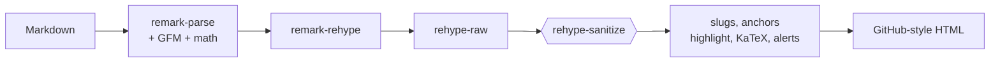

<div align="center">

# Readly

**Preview Markdown exactly like GitHub renders it, locally, before you push.**

[](https://www.npmjs.com/package/@groundworktechnologies/readly)
[](https://www.npmjs.com/package/@groundworktechnologies/readly)
[](https://nodejs.org)
[](LICENSE)

<br>


</div>

---

## Why

You edit a `README.md`, push, refresh GitHub, spot a broken table, push again. Readly cuts that loop: it renders your Markdown with the **same GitHub look** (real GitHub palette, alerts, Mermaid, math, heading anchors), in your browser, and **reloads the moment you save**.

## Install

Render Markdown exactly like GitHub does, locally, without pushing.

```sh
npx @groundworktechnologies/readly README.md           # render one file, open the browser
npx @groundworktechnologies/readly .                   # render a folder, with a sidebar of every .md file
npx @groundworktechnologies/readly README.md -p 4000   # custom port
npx @groundworktechnologies/readly README.md --no-open # don't open the browser
```

Or install it, which gives you the `readly` command:

```sh
npm install --global @groundworktechnologies/readly
readly README.md
```

It renders GitHub Flavored Markdown (tables, task lists, footnotes), syntax highlighting, Mermaid diagrams, GitHub alerts, heading anchors, and KaTeX math. Raw HTML is sanitized. Saving the file reloads the browser. Dark by default, with a light toggle.

- Listens on `127.0.0.1` only; default port 3000, next free port if busy.
- Relative images and links resolve against the file's folder, which is the only thing served (no path traversal, no dotfiles).
- Needs Node 18 or newer (developed and tested on Node 22).

Source, web app and issues: [GroundworkTechnologies/readly](https://github.com/GroundworkTechnologies/readly). The unscoped `readly` package on npm is a different, unrelated project.

> [!NOTE]
> Tested on Linux only. macOS and Windows should work (the browser-open step has code paths for both) but haven't been tried yet. Reports welcome.

## Usage

```sh
readly README.md              # render one file and open the browser
readly .                      # render a whole folder, with a sidebar of every .md file
readly docs/ -p 4000          # a subfolder, on a custom port
readly README.md --no-open    # start the server, don't open the browser
```

| Flag | What it does | Default |
| --- | --- | --- |
| `-p`, `--port <n>` | Port to listen on. If it's busy, the next free port is used. | `3000` |
| `--no-open` | Don't open the browser automatically. | opens |
| `-h`, `--help` | Show help. | |
| `-v`, `--version` | Show the version. | |

Keep the file open in your editor and hit save. The browser updates in about a second and keeps your scroll position. Relative images and links resolve against the file's folder, and in folder mode, links between `.md` files navigate to the rendered page.

## Features

| Feature | Details |
| --- | --- |
| **GitHub Flavored Markdown** | Tables, task lists, strikethrough, autolinks, footnotes |
| **Syntax highlighting** | highlight.js, coloured with GitHub's own palette |
| **Mermaid** | Rendered in the browser, re-themed when you switch theme |
| **GitHub alerts** | `[!NOTE]` `[!TIP]` `[!IMPORTANT]` `[!WARNING]` `[!CAUTION]`, with icons |
| **Math** | `$inline$` and `$$display$$` via KaTeX |
| **Heading anchors** | Slugs match GitHub's; hover shows the link icon |
| **Safe raw HTML** | `<details>`, ``, `<picture>`, `<kbd>` and similar are kept. `<script>`, `on*` handlers, `javascript:` links and `<iframe>` are removed |
| **Dark and light** | Dark by default, one click to light, remembered across visits |

### Safe by default

Only the folder you point Readly at is served, and only to your own machine. It listens on `127.0.0.1`, and it refuses `..` paths, dotfiles like `.env`, symlinks that leave the folder, and requests with a foreign `Host` header (DNS rebinding).

## Web app

The same renderer, as an editor with a live preview. It's a static site: rendering happens in your browser and nothing is uploaded.

```sh
git clone https://github.com/GroundworkTechnologies/readly.git
cd readly
npm install
npm run dev:web        # http://localhost:3000
```

- **Split view:** editor on the left, preview on the right (tabs on phones).
- **Drag and drop:** drop a `.md` file anywhere on the page.
- **Fetch from GitHub:** paste a `raw.githubusercontent.com` link or a `github.com/.../blob/...` link. Relative images and links resolve against the repo.
- **Copy HTML:** copies the sanitized rendered HTML.

`npm run build` writes the static site to `apps/web/out`, ready for any static host.

## How it works

One renderer, shared by the CLI and the web app, so they can't drift apart.



Sanitizing runs **before** anything Readly generates itself, so only user-supplied HTML is filtered and Readly's own markup (anchor icons, alert icons, KaTeX) is left intact.

```
packages/core   @readly/core                      shared renderer, theme CSS, browser hydrate (Mermaid)
packages/cli    @groundworktechnologies/readly    the `readly` command (Express + chokidar + SSE)
apps/web        @readly/web                       Next.js (App Router) + Tailwind, uses @readly/core
```

## Where it differs from GitHub

> [!WARNING]
> "Exactly like GitHub" means as close as a local renderer can get. These are the known gaps.

- Syntax colours come from highlight.js (common languages), not GitHub's Linguist grammars, so a few tokens differ and rare languages stay plain.
- `:tada:`, `@mentions`, `#123` references and commit SHAs aren't expanded, since they need a repository to resolve against.
- GitHub-only embeds (3D models, GeoJSON maps, `user-attachments` videos) aren't rendered.

## Development

```sh
npm install
npm run build          # core, then the CLI, then the web app
npm test               # renderer tests + CLI integration tests
npm link -w @groundworktechnologies/readly    # try the `readly` command from source
```

Requires Node 18+ and **npm** (the repo uses npm workspaces only).

## License

[MIT](LICENSE) © Groundwork Technologies
