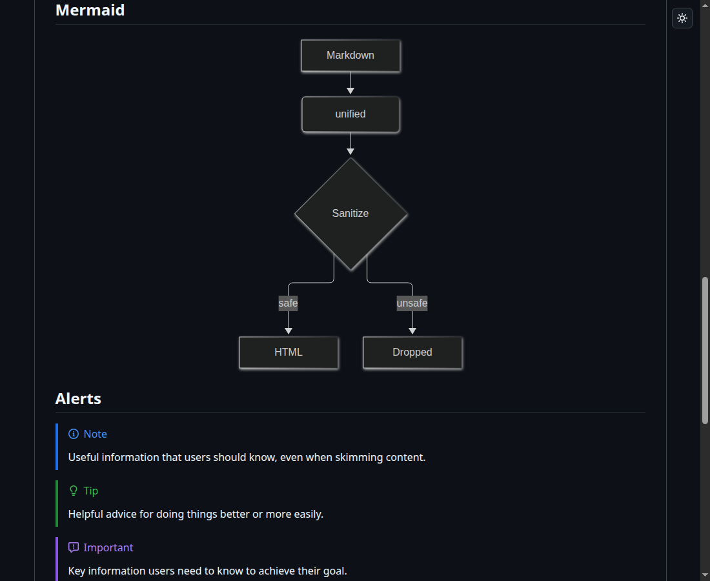
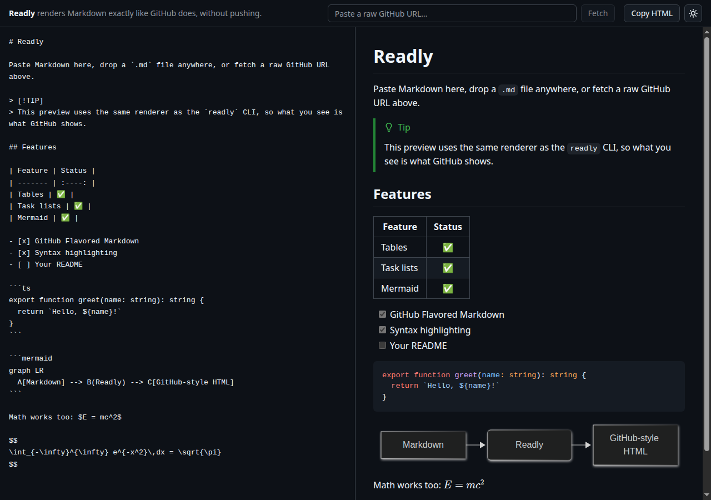

# Readly

Render Markdown exactly like GitHub does, locally, without pushing.



Two ways to use it, one shared renderer:

- **CLI**: `npx @groundwork/readly README.md` opens the rendered file in your browser and reloads when you save.
- **Web app**: paste or drop Markdown (or fetch a raw GitHub URL) and see it rendered GitHub-style.



## CLI

```sh
npx @groundwork/readly README.md           # render one file, open the browser
npx @groundwork/readly .                   # render a folder, with a sidebar of every .md file
npx @groundwork/readly README.md -p 4000   # custom port
npx @groundwork/readly README.md --no-open # don't open the browser
```

The package is published as `@groundwork/readly` because the unscoped `readly` name is taken on npm. The command it installs is still `readly`:

```sh
npm install --global @groundwork/readly
readly README.md
```

- Listens on `127.0.0.1` only. Default port is 3000; if it's busy, the next free port is used.
- Saving the file (in VS Code or anywhere else) refreshes the browser within about a second, keeping your scroll position.
- Relative images and links resolve against the file's folder. In folder mode, links between `.md` files navigate to the rendered page.
- Local files are served from the file's folder only. Path traversal, dotfiles (such as `.env`) and symlinks that point outside the folder are refused, and requests with a foreign `Host` header are rejected.
- Needs Node 18 or newer.

## Web app

```sh
npm install
npm run dev:web      # http://localhost:3000
```

- Editor on the left, live preview on the right (tabs on small screens).
- Drag and drop a `.md` file anywhere on the page.
- Paste a raw GitHub URL (`raw.githubusercontent.com/...`, or a `github.com/.../blob/...` link) and fetch it. Relative images and links resolve against the repository.
- **Copy HTML** copies the sanitized rendered HTML.
- It is a static site: rendering happens in your browser, nothing is sent to a server. `npm run build` writes it to `apps/web/out`.

## What it renders

- GitHub Flavored Markdown: tables, task lists, strikethrough, autolinks, footnotes
- Syntax-highlighted code blocks, using GitHub's own colour palette
- [Mermaid](https://mermaid.js.org) diagrams, rendered client-side and re-themed when you switch theme
- GitHub alerts: `> [!NOTE]`, `[!TIP]`, `[!IMPORTANT]`, `[!WARNING]`, `[!CAUTION]`
- Heading anchors with the hover link icon
- Math with KaTeX: `$...$` and `$$...$$`
- Raw HTML, sanitized with `rehype-sanitize` (GitHub's allow-list, plus `<picture>` and `<source>`): `<details>`, ``, `<br>`, `<picture>`, `<kbd>` and so on survive; `<script>`, event handlers, `javascript:` links and `<iframe>` do not

**Theme:** dark by default, with a toggle (top right) to switch to light. Your choice is remembered in the browser. The colours are the real `github-markdown-css` palettes.

### Where it differs from GitHub

"Exactly" means as close as a local renderer can get. The known gaps:

- Syntax colours come from highlight.js (the common languages), not GitHub's Linguist grammars, so a few tokens are coloured differently and rarer languages are left unhighlighted.
- Emoji shortcodes (`:tada:`), `@mentions`, `#123` issue references and commit SHAs are not expanded, since they need a repository to resolve against.
- GitHub-only embeds (such as STL models, GeoJSON maps and videos from `user-attachments`) are not rendered.

## How it's built

```
packages/core   @readly/core   shared renderer: markdown string -> HTML, plus the browser
                               hydrate step (Mermaid, theme) and the GitHub-palette CSS
packages/cli    @groundwork/readly   the `readly` command: Express + chokidar + Server-Sent Events
apps/web        @readly/web    Next.js (App Router) + Tailwind, imports @readly/core
```

The renderer is a [unified](https://unifiedjs.com) pipeline: `remark-parse`, `remark-gfm`, `remark-math`, `remark-rehype`, `rehype-raw`, `rehype-sanitize`, then `rehype-slug`, `rehype-autolink-headings`, `rehype-highlight`, `rehype-katex`, and small plugins for GitHub alerts and URL rewriting. Sanitizing runs **before** anything readly generates itself, so only user-supplied HTML is filtered.

## Development

```sh
npm install
npm run build      # core, then the CLI, then the web app
npm test           # core renderer tests + CLI integration tests
npm link -w @groundwork/readly   # try the `readly` command locally
```

Requires Node 18+ and npm. The repository uses npm workspaces only.
