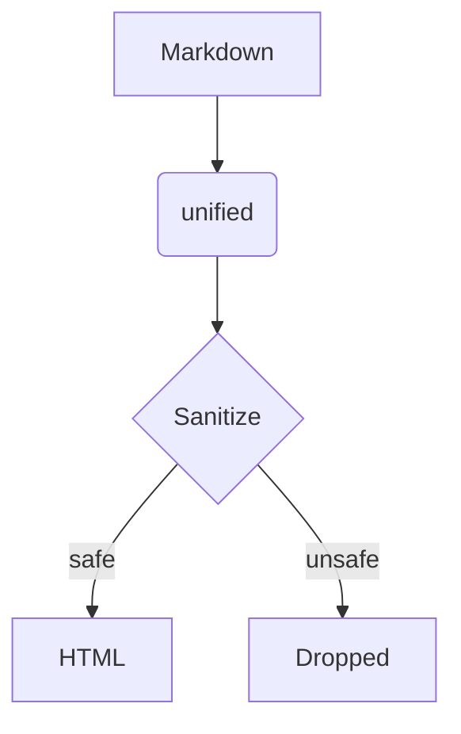

# Readly sample

A sample README that exercises every feature **readly** renders. Compare it with how GitHub shows the same file.


See [the second heading](#tables) and [another file](docs/other.md).

## Tables

| Feature        | Supported | Notes                 |
| -------------- | :-------: | --------------------: |
| Tables         |    ✅     | aligned columns       |
| Task lists     |    ✅     | see below             |
| ~~Nothing~~    |    ✅     | strikethrough in cell |

## Task lists

- [x] Write the renderer
- [x] Write the tests
- [ ] Ship it
  - [ ] nested item

## Text styling

~~Strikethrough~~, **bold**, *italic*, ***both***, `inline code`, and an autolink: https://github.com/features.

Line one with a hard break  
line two. Emoji shortcodes are not expanded: :tada:

> A normal blockquote
> spanning two lines.

## Footnotes

Here is a footnote reference[^1] and another one[^note].

[^1]: The first footnote.
[^note]: A named footnote with `code`.

## Code

```ts
interface User {
  id: number
  name: string
}

export function greet(user: User): string {
  // say hello
  return `Hello, ${user.name}!`
}
```

```bash
npm install && npm run build
```

```json
{ "name": "readly", "private": true, "count": 3 }
```

```diff
- old line
+ new line
```

## Mermaid



## Alerts

> [!NOTE]
> Useful information that users should know, even when skimming content.

> [!TIP]
> Helpful advice for doing things better or more easily.

> [!IMPORTANT]
> Key information users need to know to achieve their goal.

> [!WARNING]
> Urgent info that needs immediate user attention to avoid problems.

> [!CAUTION]
> Advises about risks or negative outcomes of certain actions.

## Math

Inline math: $E = mc^2$ and $\sum_{i=1}^{n} i = \frac{n(n+1)}{2}$.

$$
\int_{-\infty}^{\infty} e^{-x^2}\,dx = \sqrt{\pi}
$$

## HTML

<details>
<summary>Click to expand</summary>

Hidden **markdown** content inside `details`.

</details>

<picture>
  <source media="(prefers-color-scheme: dark)" srcset="images/logo.svg">
  
</picture>

<p align="center">Centered paragraph<br>with a <kbd>Ctrl</kbd>+<kbd>C</kbd> and H<sub>2</sub>O, x<sup>2</sup>.</p>

<script>alert('xss')</script>

<a href="javascript:alert('xss')">bad link</a>
<iframe src="https://example.com"></iframe>

## Duplicate heading

### Duplicate heading
